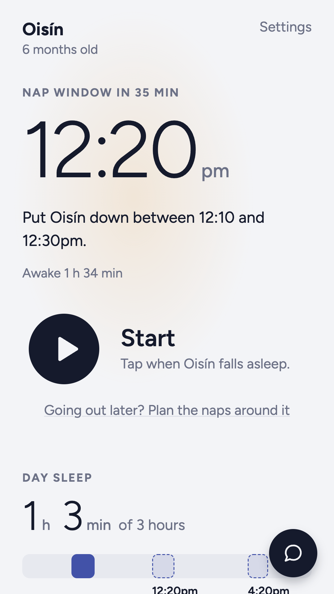
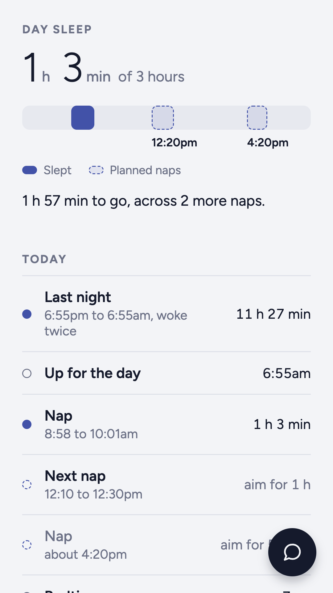
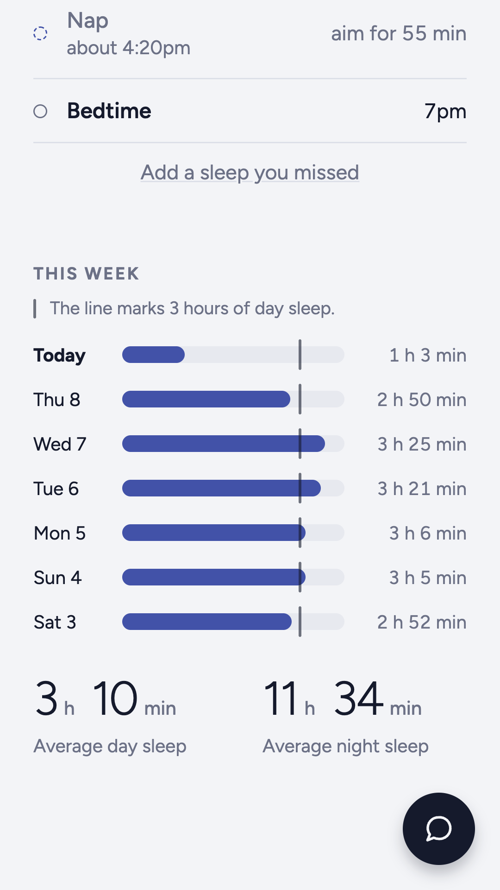

# Baby Nap Track

Baby Nap Track logs a baby's sleep with one tap and says when the next nap should start. This is
the code of the app on [Google Play](https://play.google.com/store/apps/details?id=com.spremtlabs.babysleep).

<p>
  
  
  
</p>

## What it does

- Gives the next nap time and the window to put the baby down in.
- Times a sleep. Tap when the baby falls asleep and again when the baby wakes.
- Counts the day's sleep against an aim the parent sets, and says how much nap is still needed
  before bed.
- Plans the naps around a trip out.
- Shares one log with a partner, a grandparent or a childminder through a link.
- Makes a sleep diary to send a sleep consultant or a GP.
- Walks a parent through the chair method from six months, and keeps how long settling took each
  night.

## How the nap times are worked out

`src/lib/engine.ts` holds every sum. Each age has a wake window and a usual number of naps, from
five short naps a day for a newborn to one long nap for a toddler, in `BANDS`. A baby born early
goes by the due date. Once three days are logged, the times come mostly from the baby's own naps.
A short nap brings the next one sooner, and late in the day the app suggests an earlier bedtime in
place of another nap. A nap still going at the end of the day's naps gets a time to wake the
baby, bedtime less the shortest wake window unless the parent sets another in Settings.

## Run it

You need Node 24.

```bash
npm install
```

```bash
npx expo start --web
```

That opens the app in your browser. On a phone it needs a development build, because the payment
uses native code: `npx expo run:android` or `npx expo run:ios`.

## Test it

```bash
npm test
```

That runs the tests in `test/`. The full check needs Puppeteer for a headless Chrome:

```bash
npm install --no-save puppeteer
```

```bash
npm run check
```

It type-checks, runs the tests, reads the source for the rules below, then builds the web version
and walks it at phone size through setup, a day of naps, a night, the chair method, the free week
and a log shared between two phones. Every change to the app passes it before it ships, and a
pull request here runs it too.

## Rules the code keeps

- A nap still going at the end of the day's naps gets a time to wake the baby. Settings holds
  that time as `No naps after`.
- A screen calls the baby by name. A pronoun in a string fails the check.
- Every sentence the Today screen says is worked out in `src/lib/model.ts`, and the screens only
  draw it.
- A fault becomes a test in the same change as its fix.

## Where things are

- `src/lib/engine.ts`: the wake windows, the nap times, the day sleep and the make-up nap.
- `src/lib/model.ts`: what the Today screen says.
- `src/lib/shop.ts` and `src/lib/billing.ts`: the free week and the one payment, through Google
  Play or the App Store.
- `src/lib/sync.ts` and `supabase/sharing.sql`: the shared log.
- `src/lib/chair.ts` and `src/lib/chairArt.ts`: the chair method and its picture of the bedroom.
- `src/lib/diary.ts`: the sleep diary.
- `test/sample.ts`: the sample babies the tests and the screenshots use.

## Where the data goes

Each phone keeps its own log. A shared log, the help chat and the email box in setup go to Spremt
Labs' Supabase project in the EU, and the key in the code is the public one every copy of the app
carries. This copy of the code sends no usage counts.

If you publish your own build, point `src/lib/sync.ts`, `src/lib/chat.ts` and `src/lib/signup.ts`
at a Supabase project of your own, and run the two files in `supabase/` there.

## Contributing

Issues and pull requests are welcome. The app is built from a private copy of this repo, so a
change we take is made there and arrives here with the next update. Send a security problem to
hello@spremtlabs.com.

## Licence

The code is under the MIT licence in `LICENSE`. The name Baby Nap Track, the icon and the store
pictures in `store/assets` belong to Spremt Labs. A build you publish needs a name, an icon and
pictures of its own.

Made in Ireland by Spremt Labs.
